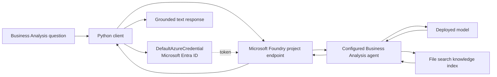
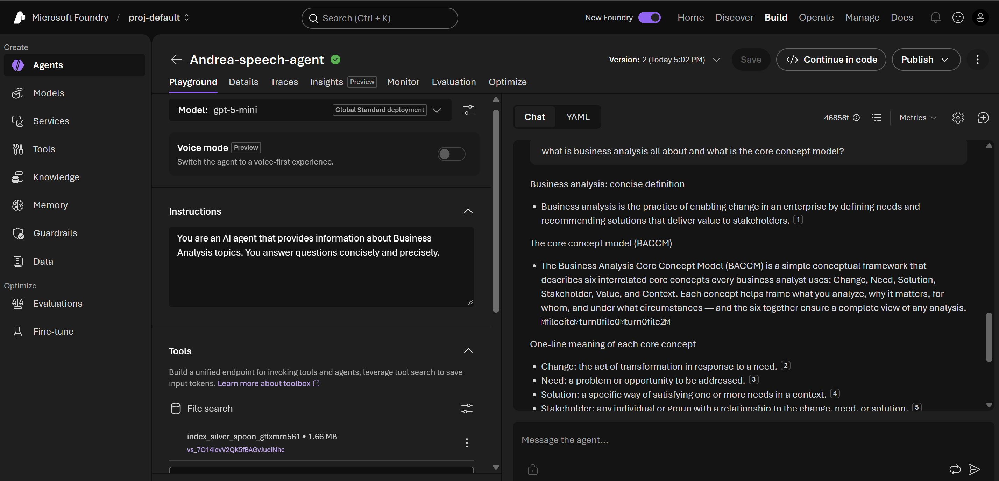

# Business Analysis Agent

A portfolio project from my **Azure AI Fundamentals learning journey**. This Python command-line client connects to a Microsoft Foundry agent that explains Business Analysis concepts, including the Business Analysis Core Concept Model (BACCM).

The Foundry agent is configured with concise Business Analysis instructions and a guide to the Business Analysis Book of Knowledge (BABOK). The repository contains the client and project documentation; the hosted agent, model deployment, and knowledge index remain configured in the Azure project.

> **Project status:** learning portfolio/demo. Azure resources are not included. You need access to a Microsoft Foundry project and a configured agent to run the client.

## What it demonstrates

- Connecting Python to an existing Microsoft Foundry project and agent
- Authenticating with Microsoft Entra ID through `DefaultAzureCredential`
- Creating a conversation and sending a Responses API turn
- Grounding explanations in a configured knowledge source through File search
- Keeping endpoint and agent configuration out of source code

## Architecture



The client starts a new conversation for each invocation. The agent's model, instructions, and File search knowledge source are set up in Foundry and are not created by this script.

## Agent screenshot

The Foundry playground screenshot shows the agent instructions, selected model, File search knowledge source, and a sample answer about Business Analysis and BACCM.



## Example prompts

1. `What is Business Analysis and what value does it provide?`
2. `Explain the six concepts in the Business Analysis Core Concept Model (BACCM).`
3. `How are a need and a solution different in Business Analysis?`
4. `Who counts as a stakeholder, and how should an analyst consider their needs?`
5. `Explain how change, context, and value relate to one another in an analysis.`

## Sample response

The attached VS Code terminal screenshot shows this sample answer to a question about Business Analysis and its core concept model:

> Business analysis enables change in an enterprise by defining needs and recommending solutions that deliver value to stakeholders. The BACCM frames analysis around six interrelated concepts: **Change, Need, Solution, Stakeholder, Value, and Context**.

This is an excerpt from the captured run. Responses are generated by the hosted model and may vary; the citation markers shown by the Foundry agent depend on BABOK.

## Run locally

### Prerequisites

- Visual Studio Code, Python 3.10 or later
- A Microsoft Foundry project with the Business Analysis agent already configured
- Permission for your signed-in identity to use the project and its model deployment
- Azure CLI installed and signed in, or another supported `DefaultAzureCredential` sign-in method

### Setup

1. Clone this repository and open its folder.
2. Create and activate a virtual environment:

   ```powershell
   py -m venv .venv
   .venv\Scripts\Activate.ps1
   ```

3. Install the packages:

   ```powershell
   python -m pip install -r requirements.txt
   ```

4. Sign in with the Azure CLI:

   ```powershell
   az login
   ```

5. Set the project endpoint and agent name from your own Foundry project. For the current PowerShell session:

   ```powershell
   $env:FOUNDRY_PROJECT_ENDPOINT = "https://<resource-name>.services.ai.azure.com/api/projects/<project-name>"
   $env:FOUNDRY_AGENT_NAME = "your-agent-name"
   ```

6. Ask a question:

   ```powershell
   python agent_client.py "Explain the six BACCM concepts."
   ```

The endpoint shown is a placeholder. Find the actual endpoint in your Foundry project and ensure your signed-in identity has the required access. Do not commit credentials, private endpoints, or local `.env` files.

## Deployment notes

This repository contains a local client, not an Azure-hosted web service. The Foundry agent and model must already exist. To make the project available as an app, a next step would be to add a web interface or API, deploy it to a hosting service, and use a managed identity with narrowly scoped access.

## Future roadmap

- [ ] Add multi-turn chat for follow-up questions
- [ ] Improve handling for sign-in, permission, and service errors
- [ ] Evaluate explanations for accuracy, clarity, and source support
- [ ] Add a broader prompt set for BACCM and common Business Analysis tasks
- [ ] Build and deploy a simple web interface with managed identity
- [ ] Monitor usage, latency, and evaluation results

## Learning reflection

This project lets me practice connecting a Python client to a hosted Foundry agent and using a knowledge source to support concise subject-specific answers. It also showed how an agent can explain a framework such as BACCM in a way that helps a user connect its concepts to a business context.

## References

- [Microsoft Foundry SDK for Python](https://learn.microsoft.com/python/api/overview/azure/ai-projects-readme?view=azure-python-preview)
- [AIProjectClient API reference](https://learn.microsoft.com/python/api/azure-ai-projects/azure.ai.projects.aiprojectclient)
- [Microsoft Foundry authentication and authorization](https://learn.microsoft.com/en-us/azure/foundry/concepts/authentication-authorization-foundry)
